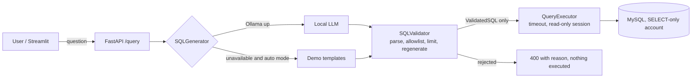
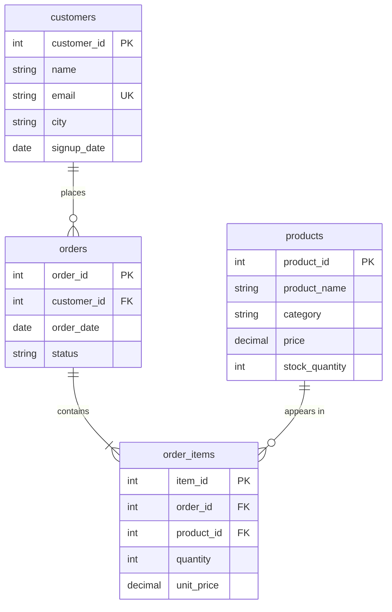

# SafeSQL: Natural Language to SQL with Security Guardrails

Ask a question in plain English and get an answer from a SQL database. A local LLM (Ollama) can draft the SQL, but SafeSQL treats that SQL as **untrusted input**: it is parsed, checked against an allowlist, row-limited, and executed by a **read-only MySQL account**. No paid APIs, no cloud services.

## Screenshots

**Web UI: generated SQL, executed SQL, explanation, results, generation mode**


**Results table (MySQL)**


**API response on MySQL (note `DATE_FORMAT`; the validator added `LIMIT 100`)**


**Database-level protection: the app account cannot read `customers.email`**


## Problem

LLM-generated SQL can be wrong *or* dangerous: `DROP TABLE`, stacked statements, reads of system tables, `SLEEP()` denial of service. Telling the model "be safe" in a prompt is not a control. SafeSQL puts independent, deterministic defences between the model and the database.

## Features

- FastAPI backend: `/health`, `/schema`, `/examples`, `/query`, with interactive docs at `/docs`
- Streamlit UI showing the generated SQL, the SQL actually executed, an explanation, results, timing and generation mode
- Local LLM via Ollama (model set by environment variable), or a clearly labelled deterministic demo fallback that answers 10 documented questions and is never presented as an LLM
- SQLGlot-based validator, table/column allowlist (PII column `customers.email` excluded), enforced row limit, query timeout
- MySQL primary database with SQLAlchemy 2; SQLite used for the disposable test database
- Idempotent init and seed scripts; least-privilege MySQL account with **column-level** `GRANT SELECT`
- 103 automated tests (pytest), Ruff linting

## Architecture



## Database schema



Constraints: unique email; `price >= 0`; `stock_quantity >= 0`; `status IN ('completed','pending','cancelled')`; `quantity > 0`; `unit_price >= 0`; foreign keys; indexes on city, category, order date/status/customer, and item order/product.

**Revenue** = `SUM(quantity * unit_price)` over order items belonging to **completed** orders.

Seed data (all fictional, deterministic): 16 customers (3 never order), 12 products (4 with stock under 10), 60 orders, 103 order items. Completed-order revenue is 311,206.

## Security design

| Layer | What it does | Why it is needed |
|---|---|---|
| Parser (SQLGlot, target dialect) | Exactly one statement; root must be SELECT/UNION; blocks DML, DDL, GRANT, `INTO`, locks, session variables | Syntax-aware rather than regex; handles comments, quoting and `;` inside strings |
| Allowlist | No schema-qualified names (blocks `information_schema`, `mysql.*`); tables must be approved or a CTE; columns resolved against the approved schema; `*` expands to approved columns only | Stops reading data the app never meant to expose |
| Function control | Untyped functions rejected unless allowlisted; `SLEEP`, `LOAD_FILE`, `VERSION`, `USER` and similar denied | Blocks denial of service and server introspection |
| Regenerate and re-verify | The executed text is regenerated from the validated AST (comments stripped), re-parsed and re-checked | Removes parser/database differences such as MySQL `/*! ... */` executable comments |
| Row limit | `LIMIT` added or lowered to `MAX_ROWS`; `fetchmany` as a second cap | Bounded responses |
| Timeout | MySQL `MAX_EXECUTION_TIME` | Bounded cost |
| Database permissions | Dedicated account, `GRANT SELECT (columns)` per table, no `email`, read-only session | Last line of defence if every check above had a bug |
| API hygiene | Input length limits, request-size limit, generic error messages, no secrets in logs | No internal leakage |

Parameterization protects application-written statements (seeding, `CREATE USER`); it does **not** make arbitrary generated SQL safe, which is why the layers above exist. The executor accepts only a `ValidatedSQL` object, which only the validator can produce, so no code path (LLM or fallback) can skip validation.

### Validator demo

Running `python try_validator.py` produced (SQLite dialect):

```
ALLOWED : SELECT name FROM customers -> SELECT customers.name AS name FROM customers AS customers LIMIT 100
BLOCKED : DROP TABLE customers -> Only SELECT queries are allowed (got DROP).
BLOCKED : SELECT * FROM customers; DELETE FROM orders -> Only a single statement is allowed.
BLOCKED : SELECT email FROM customers -> Unknown or ambiguous column/table: Column 'email' could not be resolved.
BLOCKED : SELECT * FROM sqlite_master -> Table not allowed: sqlite_master.
BLOCKED : SELECT SLEEP(5) -> Function not allowed: SLEEP.
```

## What has been verified

Verified by running it (Windows, Python 3.13, MySQL 8.0.45):

- All 103 tests pass.
- `scripts.init_db` creates the database, the restricted `safesql_app` account, the schema and the seed data in MySQL.
- `scripts.verify_db` runs as the restricted account and reports `VERIFY: OK`.
- The API and Streamlit UI returned correct results against MySQL for example questions (monthly revenue, low-stock products). All 10 demo questions are covered by automated tests on SQLite.
- MySQL itself refuses the app account access to `customers.email` (`ERROR 1143`).

Not verified:

- A real Ollama model. The LLM path is tested only against a mocked HTTP server, so model accuracy is unmeasured. Without Ollama the app runs in labelled demo mode.
- Query-timeout behaviour on MySQL. The `MAX_EXECUTION_TIME` setting is applied on each query, but a timeout has not been triggered there.

## Prerequisites (Windows)

Python 3.11+, Git, MySQL Community Server 8.0.16+ (CHECK constraints are enforced from that version), and optionally Ollama.

## Setup (PowerShell, from the project root)

```powershell
python --version; git --version
Get-Service *mysql*                  # service should be Running
python -m venv venv
.\venv\Scripts\Activate.ps1
pip install -r requirements-dev.txt
Copy-Item .env.example .env
notepad .env   # set MYSQL_ADMIN_USER and a NEW password for MYSQL_PASSWORD (the app account)
```

Create the database, restricted account, schema and data. This prompts for the admin password (hidden, nothing stored in shell history):

```powershell
python -m scripts.init_db
python -m scripts.verify_db
```

Re-running `init_db` is safe (no duplicates). `python -m scripts.init_db --reset --confirm-database safesql` **drops all SafeSQL tables first** and recreates them.

### Quick try without MySQL (SQLite)

```powershell
$env:DATABASE_URL = "sqlite:///safesql_demo.db"
python -m scripts.init_db
python -m scripts.verify_db
```

### Run

```powershell
uvicorn app.main:app --port 8000            # terminal 1 (docs: http://localhost:8000/docs)
streamlit run frontend/streamlit_app.py     # terminal 2
```

Stop with Ctrl+C. Restart by re-running the same commands.

### Local LLM (optional)

```powershell
ollama --version
ollama pull qwen2.5-coder:3b      # roughly 2 GB; about 8 GB RAM is a reasonable minimum
ollama run qwen2.5-coder:3b "say hi"
```

Too heavy? Set `OLLAMA_MODEL=qwen2.5-coder:1.5b` (about 1 GB). Without Ollama, `LLM_MODE=auto` falls back to the labelled demo mode. Sizes are approximate; check `ollama list`. Model accuracy on your questions must be measured, not assumed.

### API examples

```powershell
Invoke-RestMethod http://localhost:8000/health
Invoke-RestMethod -Method Post http://localhost:8000/query -ContentType 'application/json' `
  -Body '{"question":"Which products have fewer than ten units in stock?"}'
```

```bash
curl -X POST http://localhost:8000/query -H "Content-Type: application/json" \
  -d '{"question":"Which cities have the most customers?"}'
```

### Example questions (demo mode supports exactly these patterns)

- Show the five customers who spent the most.
- Which products have fewer than ten units in stock?
- What was the total revenue from completed orders by month?
- Which cities have the most customers?
- How many orders are pending?
- Show the top-selling products by quantity.
- Which customers have never placed an order?
- What is the average value of completed orders?
- What is the revenue by product category?
- What is the total revenue from completed orders?

### Tests

```powershell
python -m pytest        # uses a disposable SQLite database; never touches MySQL
ruff check .
```

## Troubleshooting

- **`Access denied` during init:** wrong `MYSQL_ADMIN_USER` or admin password. Test it with `mysql.exe -u <admin> -p` first.
- **`Can't connect to MySQL`:** start the service (`Start-Service MySQL80`; the name may differ).
- **`/health` shows `llm: unavailable`:** expected without Ollama. Start `ollama serve` and pull the model to enable the LLM.
- **Port 8000 already in use:** an old uvicorn is still running; stop it with Ctrl+C.
- **Streamlit says the backend is unreachable:** start uvicorn first, or set `SAFESQL_API_URL`.
- **App shows SQLite results instead of MySQL:** the `DATABASE_URL` variable is still set in that terminal; run `Remove-Item Env:DATABASE_URL`.

## Limitations

- Typed SQL functions are controlled by a denylist; untyped ones by an allowlist. Database permissions are the backstop.
- Single read-only database; no API authentication, rate limiting or multi-tenant row-level security.
- The request-size limit checks `Content-Length` only.
- Result explanations are template-based, not LLM-written, to avoid hallucinated commentary.
- Schema pruning for the LLM prompt is keyword-based.
- Real-model (Ollama) accuracy has not been measured.

## Future improvements

API authentication and rate limiting, per-user row-level security, query cost checks via `EXPLAIN`, an evaluation set to measure model accuracy, Docker Compose, CI with GitHub Actions.

## License

MIT
